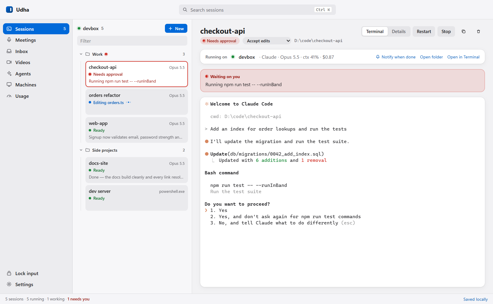
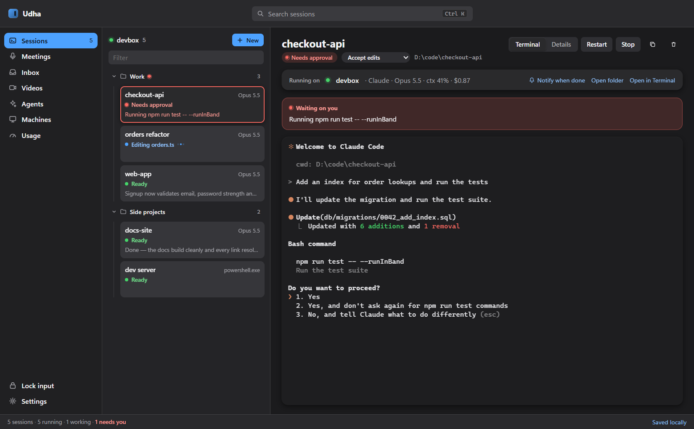
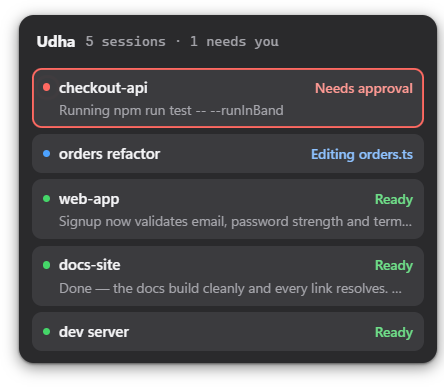

# Udha for Windows

A native Windows build of Udha's session board: no WSL, no tmux. The session
logic and the design follow the mac app at the repo root (`SessionManager`,
`ClaudeStatusSidecar`, `SessionStatusPresentation`, `UdhaTheme`).







*Screenshots use demo projects. The edge overlay (last image) is a hairline strip on the screen's right edge that
blooms into this panel on hover.*

**Current version: 0.2.0** (git tag `v0.2.0`). See [Status](#status) for
what's done and what's left.

```powershell
npm install
npm start
npm test
```

## Build the app

```powershell
npm run dist     # → dist\Udha Setup <version>.exe  (installs per-user, Start menu + desktop shortcut)
npm run pack     # → dist\win-unpacked\Udha.exe     (no installer, for a quick check)
npm run icon     # re-render build\icon.png and the tray icons
```

The installer isn't code-signed, so the first time you run it SmartScreen asks:
**More info → Run anyway**. Uninstalling keeps `%APPDATA%\Udha`, so your
sessions survive a reinstall.

## Status

### Done in 0.2.0

| Feature | Notes |
| --- | --- |
| Sessions, saved locally | ConPTY per session; restored on launch; Claude resumes with `--resume` |
| Status without an LLM | Claude hooks + statusLine; screen rules for Codex, Qwen and shells |
| Notifications | Toasts when a session needs you or finishes; taskbar badge; "Notify when done" |
| Tray | Closing the window keeps sessions running; Start with Windows |
| Folders and hiding | Collapsible folders, drag to file, hide, "Unhide all", right-click menus |
| Duplicate / permission mode | Change mode in place; a running session restarts and resumes |
| Attachments | Drop files or paste screenshots; they reach the session as paths |
| Git worktrees | New session on its own branch in `<repo>-wt\<branch>` |
| Agents | Reusable `.md` prompts, run in a folder or next to a session |
| Machines | CPU, memory, network, GPU, disks, top processes, toolchain |
| Usage | Claude logins, 5-hour / weekly limits, moving a session to another login, failover |
| Edge overlay | Session ticks on the right edge; hover to see all, click to jump |
| Meetings | Mic + call audio as You / Them, transcript, notes, action items, Ask |
| Videos | Screen recorder with camera bubble, captions, translation, burned-in exports |
| Inbox | Slack DMs and mentions per thread, reply from Udha |
| Input lock | Shield on every display, PIN to unlock |

### Tested only against mocks so far

- Meetings / Videos transcription (ElevenLabs or a Whisper URL) and notes / Ask /
  caption translation (Anthropic or Ollama): tested against local fake servers,
  not yet with real keys.
- Slack inbox: tested against a local fake Slack API only.
- Usage failover: unit-tested; needs a second login hitting a real limit.

### Not done yet (future work)

- **Phone app and remote machines** (relay + Auth0, session hand-off): needs
  your relay server and Auth0 tenant (`../udha/relay`, `../udha/docs/self-hosting.md`).
- Videos: joining clips; publishing to a share backend.
- Meetings: naming from the calendar, process diagram, split / join, transcript translation.
- Input lock: Windows Hello instead of a PIN.
- Code signing for the installer.

## How resume works

A new Claude session is started with `--session-id <uuid>`, so Udha knows the
conversation id from the start. If you run `/clear`, Claude makes a new id;
the `SessionStart` hook reports it and Udha saves it. On the next launch,
Udha uses `--resume <id>` if `~/.claude/projects/*/<id>.jsonl` exists, and
otherwise starts fresh with the same id. Moving a session to another login
copies its transcript into that login's `projects` folder first.

## Where things are saved

Everything lives in `%APPDATA%\Udha`:

| Path | What |
| --- | --- |
| `config.json` | sessions, folders, settings, logins, lock PIN hash |
| `secrets.json` | API keys and Slack tokens, encrypted with Windows DPAPI |
| `status\` | per-session hook / statusLine feed |
| `attachments\<session>\` | pasted images |
| `Agents\*.md` | agents |
| `Meetings\<id>\` | meeting audio, transcript and notes |
| `Recordings\<id>\` | recordings, captions and exports |
| `slack-inbox.json` | the inbox record |
| `logins\<name>\` | extra Claude logins (`CLAUDE_CONFIG_DIR`) |

## Layout

| File | Role |
| --- | --- |
| `src/main/main.js` | window, IPC wiring, settings |
| `src/main/config.js` | config store (tolerant load, atomic save, backup of a broken file) |
| `src/main/sessions.js` | pty lifecycle, resume, hook feed, screen reading, login moves |
| `src/main/status.js` / `panes.js` | pure status rules (tested) |
| `src/main/hook.js` | run by Claude for hooks and statusLine |
| `src/main/notify.js`, `tray.js`, `overlay.js`, `lock.js` | notifications, tray, edge overlay, input lock |
| `src/main/folders.js`, `git.js`, `agents.js` | folders, worktrees, agents |
| `src/main/machines.js`, `usage.js` | stats, Claude logins and limits |
| `src/main/meetings.js`, `recordings.js`, `slack.js`, `secrets.js` | meetings, videos, inbox, encrypted keys |
| `src/renderer/app.js` | sessions board and pane, sheets, palette, section switching |
| `src/renderer/<section>.js` | one file per nav section |

## Developing

- `UDHA_DATA_DIR=<folder>` runs against a scratch folder instead of `%APPDATA%\Udha`.
- `UDHA_SCREENSHOT=<file.png>` (with `UDHA_SCREENSHOT_DELAY`, `UDHA_DEV_JS`)
  captures the window and quits, printing renderer errors. Used for checks
  without clicking through the app.
- `UDHA_SLACK_API=<url>` points the Slack client at a local mock.
